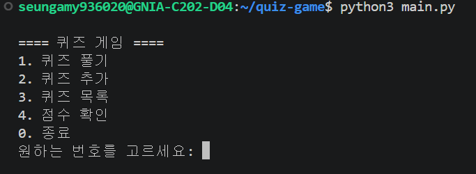
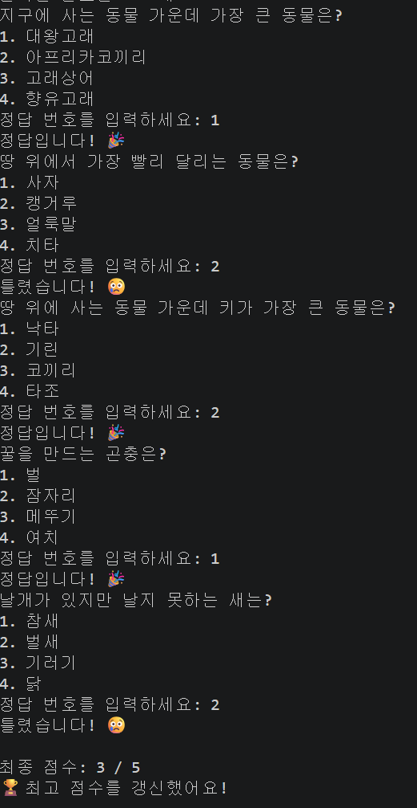
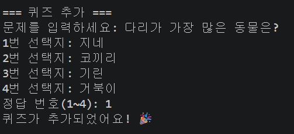
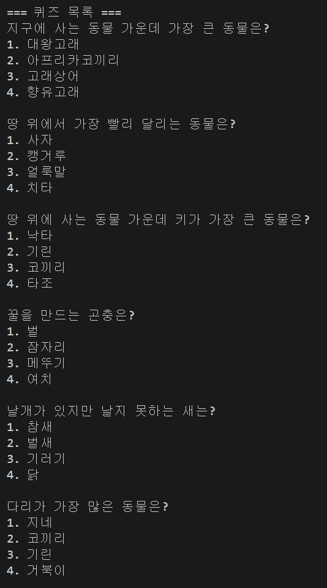
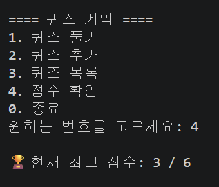

# 🐾 동물 퀴즈 게임

동물에 대한 다양한 상식을 퀴즈로 풀어보는 콘솔 게임입니다.

## 📌 주제 선정 이유

동물은 누구에게나 **친숙한 주제**라서, 남녀노소 누구나 부담 없이
즐길 수 있을 것 같아 선택했습니다. 🐘🐢🦁

## 🚀 실행 방법

```bash
python main.py
```


🎮 기능 목록

기능	설명
퀴즈 풀기	등록된 문제를 순서대로 풀고 점수를 확인
퀴즈 추가	새로운 문제·선택지·정답을 직접 등록
퀴즈 목록 보기	등록된 모든 문제를 확인
점수 확인	최고 점수 확인
자동 저장/불러오기	프로그램 종료 후에도 데이터 유지


📂 파일 구조

quiz-game/
├─ main.py        # 실행 파일 (전체 게임 로직)
├─ state.json     # 퀴즈 데이터 & 최고 점수 저장 파일
├─ .gitignore     # git 추적 제외 목록
└─ README.md      # 프로젝트 설명 문서


💾 state.json 설명

퀴즈 데이터와 최고 점수를 JSON 형식으로 저장합니다.

퀴즈를 추가하거나 점수가 갱신되면 자동으로 저장됩니다.
파일이 없거나 손상된 경우, 기본 퀴즈 데이터로 복구됩니다. 🛡️


## 📸 실행 화면

### 🏠 메인 메뉴


### 🎮 퀴즈 풀기


### 🎮 퀴즈 추가


### 🎮 퀴즈 목록


### 🎮 점수 확인
