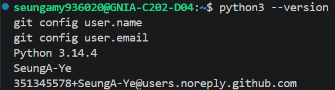
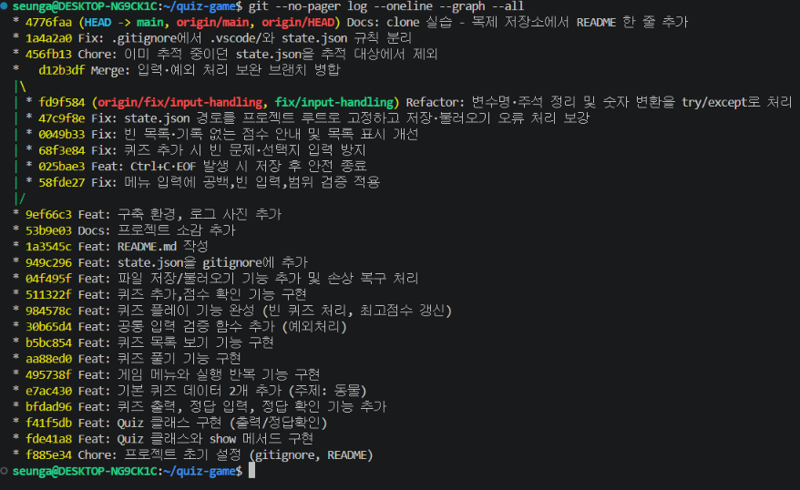

# 🐾 동물 퀴즈 게임

동물에 대한 다양한 상식을 퀴즈로 풀어보는 **터미널(콘솔) 게임**입니다.
Python 기본 문법과 클래스(`Quiz`, `QuizGame`)로 구현했고, 퀴즈와 최고 점수는 `state.json`에 저장되어 프로그램을 다시 실행해도 유지됩니다.

## 📌 주제 선정 이유

동물은 누구에게나 **친숙한 주제**라서, 남녀노소 누구나 부담 없이 즐길 수 있을 것 같아 선택했습니다. 🐘🐢🦁

## 🚀 실행 방법

**개발 환경:** Python 3.10 이상 (외부 라이브러리 없음, 표준 라이브러리 `json`, `pathlib`만 사용)

```bash
git clone https://github.com/SeungA-Ye/quiz-game.git
cd quiz-game
python3 main.py        # Windows는 python main.py
```

## 🎮 기능 목록

| 메뉴 | 기능 | 설명 |
|---|---|---|
| 1 | 퀴즈 풀기 | 등록된 문제를 순서대로 풀고 정답 여부와 최종 점수를 확인 |
| 2 | 퀴즈 추가 | 문제, 선택지 4개, 정답 번호를 입력해 새 퀴즈 등록 |
| 3 | 퀴즈 목록 | 등록된 모든 문제를 번호와 함께 확인 |
| 4 | 점수 확인 | 최고 점수 확인 (기록이 없으면 안내) |
| 0 | 종료 | 게임 종료 |
| - | 자동 저장/불러오기 | 퀴즈 추가·최고 점수 갱신 시 자동 저장, 실행 시 자동 불러오기 |

### 입력·예외 처리

| 상황 | 처리 |
|---|---|
| 앞뒤 공백 (` 1 `) | 공백 제거 후 처리 |
| 빈 입력 (Enter) | 안내 후 다시 입력 |
| 숫자가 아님 (`abc`) | 안내 후 다시 입력 |
| 범위 밖 숫자 (메뉴 `9`, 정답 `0`) | 안내 후 다시 입력 |
| `Ctrl+C` / 입력 종료(EOF) | 안내 메시지 출력 → 저장 → 안전 종료 |
| `state.json` 없음 | 기본 퀴즈 5개로 시작 |
| `state.json` 손상 | 안내 후 기본 퀴즈로 복구 |

## 📂 파일 구조

```
quiz-game/
├── main.py              # 실행 파일 (Quiz, QuizGame 클래스 및 게임 로직)
├── state.json           # 퀴즈 데이터 & 최고 점수 저장 파일 (실행 시 자동 생성, Git 추적 제외)
├── .gitignore           # Git 추적 제외 목록
├── README.md            # 프로젝트 설명 문서
└── docs/
    └── screenshots/     # 실행 화면 및 개발 환경 캡처
```

### 클래스 구조

| 클래스 | 역할 | 주요 메서드 |
|---|---|---|
| `Quiz` | 퀴즈 1개(문제·선택지·정답) | `show()` 출력, `is_correct()` 정답 확인, `to_dict()` / `from_dict()` 저장 형식 변환 |
| `QuizGame` | 게임 전체 관리 | `run()` 메뉴 반복, `play_quiz()`, `add_quiz()`, `show_list()`, `show_score()`, `save()`, `load()` |

## 💾 데이터 파일 설명 (state.json)

| 항목 | 내용 |
|---|---|
| 경로 | 프로젝트 루트 `quiz-game/state.json` (어느 위치에서 실행해도 `main.py`와 같은 폴더에 저장) |
| 역할 | 퀴즈 목록과 최고 점수를 저장해, 프로그램을 종료해도 데이터를 유지 |
| 인코딩 | UTF-8 (`ensure_ascii=False`로 한글을 그대로 저장) |
| 저장 시점 | 퀴즈 추가 시, 최고 점수 갱신 시, `Ctrl+C`로 종료 시 |

**스키마**

| 키 | 타입 | 설명 |
|---|---|---|
| `quizzes` | list | 퀴즈 객체 목록 |
| `quizzes[].question` | str | 문제 |
| `quizzes[].choices` | list[str] | 선택지 4개 |
| `quizzes[].answer` | int | 정답 번호 (1~4) |
| `best_score` | int | 최고 점수 (가장 많이 맞힌 문제 수) |

```json
{
  "quizzes": [
    {
      "question": "지구에 사는 동물 가운데 가장 큰 동물은?",
      "choices": ["대왕고래", "아프리카코끼리", "고래상어", "향유고래"],
      "answer": 1
    }
  ],
  "best_score": 4
}
```

## 📸 실행 화면

### 🏠 메인 메뉴


### 🎮 퀴즈 풀기


### ➕ 퀴즈 추가


### 📋 퀴즈 목록


### 🏆 점수 확인


### 🛠️ 개발 환경 (Python 버전 · Git 설정)


### 🌿 Git 커밋 그래프 (`git log --oneline --graph --all`)


## 🌿 Git 작업 흐름

| 단계 | 사용 명령 | 내용 |
|---|---|---|
| 저장소 시작 | `git init`, `git add`, `git commit`, `git push` | `.gitignore`, `README.md` 작성 후 첫 커밋·푸시 |
| 기능 단위 커밋 | `git add`, `git commit` | 메뉴 → Quiz 클래스 → 퀴즈 풀기 → 목록 → 추가·점수 → 저장/불러오기 → README 순서로 커밋 |
| 브랜치 작업 | `git checkout -b fix/input-handling` | 입력·예외 처리 보완 6개 커밋을 별도 브랜치에서 진행 |
| 병합 | `git checkout main`, `git merge --no-ff fix/input-handling` | 병합 기록이 그래프에 남도록 `--no-ff` 사용 |
| 복제 실습 | `git clone ... quiz-game-clone` | 별도 폴더에 복제 후 README에 한 줄 추가 → commit → push |
| 가져오기 실습 | `git pull` | 원래 작업 폴더에서 pull로 변경사항 반영 확인 |

## 💭 프로젝트 소감

처음으로 Git과 클래스를 활용해 완성한 프로젝트라 뿌듯하다!

> 이 줄은 복제한 저장소(quiz-game-clone)에서 추가했습니다. (clone·pull 실습)
